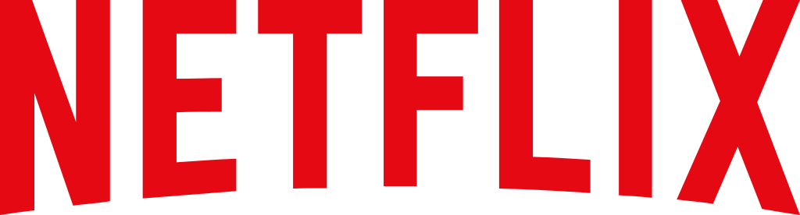
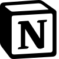
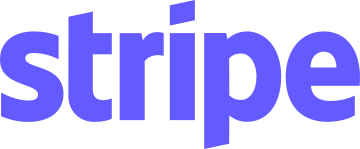

<p align="center">
  
</p>

<h1 align="center">design.md library</h1>

<p align="center"><em>great artists steal to learn.</em></p>

<p align="center">
  <a href="https://design.nickharty.com">design.nickharty.com</a>
</p>


A free collection of in-depth `DESIGN.md` files for brands people study: Letterboxd, Instagram, Stripe, Penn and more. Each one documents a brand's colors, type, components, spacing, motion, voice and logo, and ends with a prompt and a block of CSS variables you can hand straight to a coding agent. Every design ships with its vector logo.

Drop a `DESIGN.md` at the root of a project and Claude Code, Cursor, Codex or any agent that reads repo context will pick it up. Then ask for the look:

```
Build the settings page following DESIGN.md.
```

## The designs

| | Brand | Category | In one line | |
|---|---|---|---|---|
|  | [Airbnb](designs/airbnb/DESIGN.md) | Travel | Warm, photo-led white canvas with one coral-pink accent and soft rounded cards. | [preview](https://design.nickharty.com/airbnb) |
|  | [Facebook](designs/facebook/DESIGN.md) | Social | Friendly, dense, blue-and-grey feed UI built for billions of daily scrolls. | [preview](https://design.nickharty.com/facebook) |
|  | [Instagram](designs/instagram/DESIGN.md) | Social | Photo-first, chrome-light grid with a warm gradient glyph and one action blue. | [preview](https://design.nickharty.com/instagram) |
|  | [Letterboxd](designs/letterboxd/DESIGN.md) | Social | Dark, cinematic, poster-first social diary for film lovers. | [preview](https://design.nickharty.com/letterboxd) |
|  | [Linear](designs/linear/DESIGN.md) | Productivity | Near-black, precise and fast: Inter at odd weights, hairline borders, indigo accents. | [preview](https://design.nickharty.com/linear) |
|  | [Netflix](designs/netflix/DESIGN.md) | Entertainment | Black canvas, red signal, wall-to-wall artwork: a streaming UI built for the couch. | [preview](https://design.nickharty.com/netflix) |
|  | [Notion](designs/notion/DESIGN.md) | Productivity | Quiet, paper-like workspace: warm greys, black ink, one blue, hand-drawn people. | [preview](https://design.nickharty.com/notion) |
|  | [Spotify](designs/spotify/DESIGN.md) | Music | Dark, cover-art-led player UI with a single bright green and pill controls. | [preview](https://design.nickharty.com/spotify) |
|  | [Storiara](designs/storiara/DESIGN.md) | Entertainment | Near-black, indigo-lit pre-production software for film and TV crews. | [preview](https://design.nickharty.com/storiara) |
|  | [Stripe](designs/stripe/DESIGN.md) | Developer | Precise, light-weight type on white, blurple accents and a flowing gradient hero. | [preview](https://design.nickharty.com/stripe) |
|  | [University of Pennsylvania](designs/upenn/DESIGN.md) | Education | Penn Blue and Penn Red on white, Garamond headlines, and a shield dating to 1740. | [preview](https://design.nickharty.com/upenn) |
|  | [X](designs/x/DESIGN.md) | Social | Black, text-first timeline with Chirp type, hairline dividers and a single sky blue. | [preview](https://design.nickharty.com/x) |

## Get a file

From the site: open a brand and use **DESIGN.md**, **logo.svg** or **both as .zip**. Each card on the home page also has a one-click `.md` download.

From a terminal:

```bash
curl -o DESIGN.md https://design.nickharty.com/designs/letterboxd/DESIGN.md
curl -o logo.svg  https://design.nickharty.com/designs/letterboxd/logo.svg
```

Every file is also listed in [`/designs/index.json`](https://design.nickharty.com/designs/index.json), with CORS open, so scripts and agents can fetch the whole library.

Or clone this repo. The files live in `designs/<slug>/`.

## What's in a DESIGN.md

YAML frontmatter holds the tokens (colors, fonts with Google Fonts fallbacks, type scale, radii, spacing, shadows and a small `preview` palette). The site uses it to draw each preview page. The markdown body has the same eleven sections in every file:

1. Visual theme and atmosphere
2. Color palette and roles
3. Typography
4. Logo and brand mark
5. Components
6. Layout and spacing
7. Depth, elevation and motion
8. Iconography and imagery
9. Voice and microcopy
10. Do's and don'ts
11. Agent prompt guide

The full format is in [SPEC.md](SPEC.md).

## Adding a brand

1. Make `designs/<slug>/` with a `DESIGN.md` that follows [SPEC.md](SPEC.md) and a clean `logo.svg` (vector only, has a viewBox, no scripts or embedded images).
2. Run `npm run dev` and check `/<slug>`. The card, preview page and downloads come from those two files with no other code changes.
3. Open a pull request. Say where your values came from (live CSS, published brand guidelines) and flag anything you guessed.

## Running the site

```bash
npm install
npm run dev     # http://localhost:3000
npm run build
```

Next.js 15 (App Router, every page static), Tailwind 3, and components from [React Bits](https://reactbits.dev): the holographic cards are built on its ProfileCard, with DotGrid, BlurText, ShinyText, CountUp, ScrollVelocity, SpotlightCard, GlareHover, DecryptedText, StarBorder, Magnet and ClickSpark around them. The look, fonts and dots come from [nickharty.com](https://nickharty.com). `scripts/sync-designs.mjs` copies the files into `public/designs` before every build. Hosted on Vercel.

## Legal

These files are unofficial references written from public products and published brand guidelines. They are not affiliated with or endorsed by any of the brands. Logos and brand names are trademarks of their owners and are included so the references are complete; follow each brand's own guidelines before using its logo. Values marked as approximate in a file are best estimates.

Site code is MIT. The DESIGN.md text is CC BY 4.0.

Made by [Nick Harty](https://nickharty.com).
