<p align="center">
  
</p>

<h1 align="center">brands.md</h1>

<p align="center"><em>great artists steal to learn.</em><br/>Open-sourced DESIGN.md files for 200+ brands.</p>

<p align="center">
  <a href="https://brands.nickharty.com">brands.nickharty.com</a>
</p>


`DESIGN.md` files for brands people study: the top App Store apps, the biggest tech and finance companies, Hollywood studios and streaming services, news outlets, the Ivy League, and YC and the major accelerators. Each one covers a brand's colors, type, components, spacing, motion, voice and logo, and ends with a prompt and CSS variables for a coding agent. Every design ships with its vector logo and a square app icon (the brand's official App Store icon, pulled with Apple's iTunes Lookup API by `scripts/fetch-app-icons.mjs`, where the brand has its own app; otherwise a vector icon).

Drop a `DESIGN.md` at the root of a project and Claude Code, Cursor, Codex or any agent that reads repo context will pick it up. Then ask for the look:

```
Build the settings page following DESIGN.md.
```

## The designs

| | Brand | Category | In one line | |
|---|---|---|---|---|
|  | [500 Global](designs/500-global/DESIGN.md) | Accelerator | Cream paper, deep teal ink, light serif headlines and a lime highlighter accent. | [preview](https://brands.nickharty.com/500-global) |
| 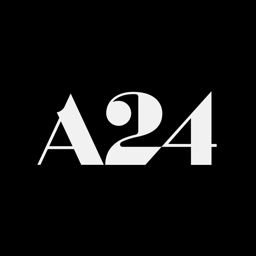 | [A24](designs/a24/DESIGN.md) | Studio | Warm black, square corners, one grotesque and the poster doing all the talking. | [preview](https://brands.nickharty.com/a24) |
| 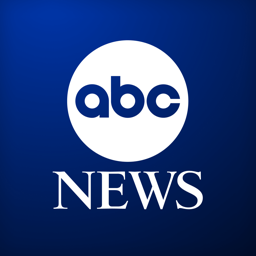 | [ABC News](designs/abc-news/DESIGN.md) | News | Black-and-white abc circle, tight Post Grotesk headlines, Tiempos body text, blue actions. | [preview](https://brands.nickharty.com/abc-news) |
|  | [Accenture](designs/accenture/DESIGN.md) | Productivity | Black canvas, bold Graphik headlines and a single electric purple greater-than sign. | [preview](https://brands.nickharty.com/accenture) |
|  | [Acorns](designs/acorns/DESIGN.md) | Finance | Acorn green, charcoal pill buttons, bold Avenir Next and color-blocked hero slides. | [preview](https://brands.nickharty.com/acorns) |
|  | [Adyen](designs/adyen/DESIGN.md) | Finance | Enterprise payments in deep navy and signal green, with a blocky pixel-cut wordmark. | [preview](https://brands.nickharty.com/adyen) |
| 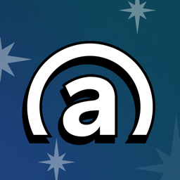 | [Affirm](designs/affirm/DESIGN.md) | Finance | Friendly pay-over-time brand: indigo arc, Axiforma headlines, pill buttons on white. | [preview](https://brands.nickharty.com/affirm) |
| 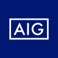 | [AIG](designs/aig/DESIGN.md) | Insurance | AIG navy header, outlined box logo, Futura headlines and square uppercase buttons. | [preview](https://brands.nickharty.com/aig) |
|  | [Airbnb](designs/airbnb/DESIGN.md) | Travel | Warm, photo-led white canvas with one coral-pink accent and soft rounded cards. | [preview](https://brands.nickharty.com/airbnb) |
|  | [Al Jazeera](designs/al-jazeera/DESIGN.md) | News | Gold calligraphy emblem, custom Al-Jazeera sans, blue links and red live tickers on white. | [preview](https://brands.nickharty.com/al-jazeera) |
| 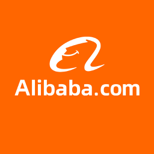 | [Alibaba](designs/alibaba/DESIGN.md) | Commerce | Busy B2B marketplace: giant search bar, warm orange actions, dense product grids. | [preview](https://brands.nickharty.com/alibaba) |
| 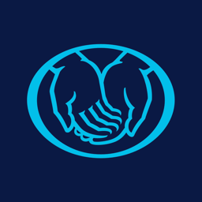 | [Allstate](designs/allstate/DESIGN.md) | Insurance | Good Hands blue, deep navy and sky accents, lowercase headlines and rounded buttons. | [preview](https://brands.nickharty.com/allstate) |
| 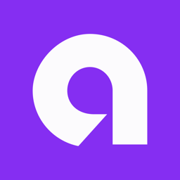 | [Ally](designs/ally/DESIGN.md) | Banking | Electric plum, highlighter lime and leaf-cornered cards for a friendly online bank. | [preview](https://brands.nickharty.com/ally) |
| 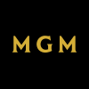 | [Amazon MGM Studios](designs/amazon-mgm-studios/DESIGN.md) | Studio | Gold, widely spaced capitals on black, with MGM's lion heritage behind them. | [preview](https://brands.nickharty.com/amazon-mgm-studios) |
|  | [AMD](designs/amd/DESIGN.md) | Hardware | Black and white with teal and gold accents, Klavika headlines and sharp 2px buttons. | [preview](https://brands.nickharty.com/amd) |
| 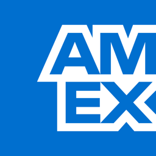 | [American Express](designs/american-express/DESIGN.md) | Finance | Bright blue box logo, deep blue panels, BentonSans type and rounded member cards. | [preview](https://brands.nickharty.com/american-express) |
|  | [Antler](designs/antler/DESIGN.md) | Accelerator | Warm off-white pages, black square-cornered buttons that flash red, a pale mint accent. | [preview](https://brands.nickharty.com/antler) |
|  | [Apollo](designs/apollo/DESIGN.md) | Finance | Warm cream and near-black, big Garamond headlines, Graphik UI and black pill buttons. | [preview](https://brands.nickharty.com/apollo) |
|  | [Apple](designs/apple/DESIGN.md) | Hardware | Product-first pages: huge photography, SF Pro headlines, grey tiles, blue pill buttons. | [preview](https://brands.nickharty.com/apple) |
| 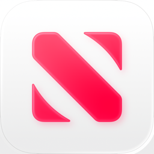 | [Apple News](designs/apple-news/DESIGN.md) | News | Native iOS news feed: SF Pro, red section titles, rounded story cards and publisher logos. | [preview](https://brands.nickharty.com/apple-news) |
| 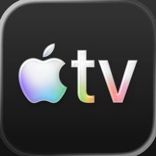 | [Apple TV](designs/apple-tv/DESIGN.md) | Streaming | Black glass, white type, and full-bleed key art: Apple's restraint applied to TV. | [preview](https://brands.nickharty.com/apple-tv) |
| 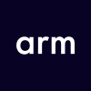 | [Arm](designs/arm/DESIGN.md) | Hardware | Deep midnight navy, a lowercase wordmark, lilac and electric-blue pills in Aeonik. | [preview](https://brands.nickharty.com/arm) |
|  | [ASML](designs/asml/DESIGN.md) | Hardware | Deep ASML blue, light-blue gradients, Neue Haas Grotesk and clean technical storytelling. | [preview](https://brands.nickharty.com/asml) |
|  | [Atlassian](designs/atlassian/DESIGN.md) | Productivity | Teamwork blue, Charlie type on the website and the Atlassian Design System in product. | [preview](https://brands.nickharty.com/atlassian) |
| 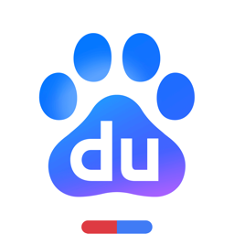 | [Baidu](designs/baidu/DESIGN.md) | AI | Sparse white search page, a blue paw, a rounded search bar and a red-numbered hot list. | [preview](https://brands.nickharty.com/baidu) |
| 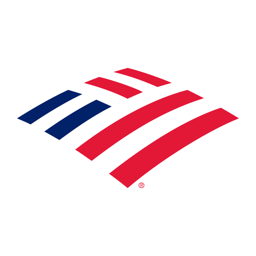 | [Bank of America](designs/bank-of-america/DESIGN.md) | Banking | Navy and red flagscape, Connections type, pill buttons and a red sign-in strip on white. | [preview](https://brands.nickharty.com/bank-of-america) |
| 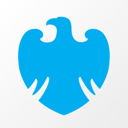 | [Barclays](designs/barclays/DESIGN.md) | Banking | Cyan eagle on white, Effra type, pill buttons in action blue and colour-themed panels. | [preview](https://brands.nickharty.com/barclays) |
| 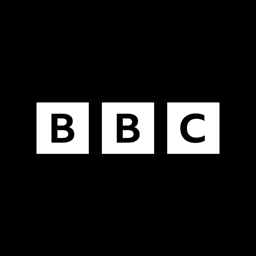 | [BBC News](designs/bbc-news/DESIGN.md) | News | Reith Serif headlines on white, black BBC blocks, square cards and a red live marker. | [preview](https://brands.nickharty.com/bbc-news) |
|  | [Berkshire Hathaway](designs/berkshire-hathaway/DESIGN.md) | Finance | A plain 1990s HTML page: navy Times text, purple links, horizontal rules and no CSS. | [preview](https://brands.nickharty.com/berkshire-hathaway) |
| 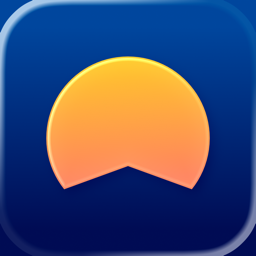 | [Betterment](designs/betterment/DESIGN.md) | Finance | Navy and gold, serif Season Mix headlines, blue buttons and offset hard-shadow cards. | [preview](https://brands.nickharty.com/betterment) |
| 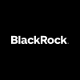 | [BlackRock](designs/blackrock/DESIGN.md) | Finance | Black and white with a sharp orange accent, heavy BLK Fort headlines and 2px corners. | [preview](https://brands.nickharty.com/blackrock) |
| 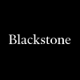 | [Blackstone](designs/blackstone/DESIGN.md) | Finance | Monochrome and editorial: a black box wordmark, Garamond-style serif, wide photography. | [preview](https://brands.nickharty.com/blackstone) |
|  | [Block](designs/block/DESIGN.md) | Finance | Black-and-white grid of nine squares, lowercase wordmark, Cash Sans and uppercase nav. | [preview](https://brands.nickharty.com/block) |
| 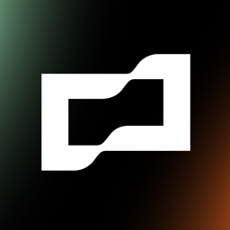 | [Brex](designs/brex/DESIGN.md) | Finance | Crisp white finance software with near-black ink, Inter type and one hot orange CTA. | [preview](https://brands.nickharty.com/brex) |
|  | [Brown University](designs/brown/DESIGN.md) | Education | Seal brown and cardinal red on warm white, Minion Pro headlines and Circular UI. | [preview](https://brands.nickharty.com/brown) |
| 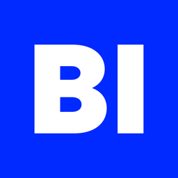 | [Business Insider](designs/business-insider/DESIGN.md) | News | Black caps wordmark, Insider Blue links and Tiempos body text on a clean white news grid. | [preview](https://brands.nickharty.com/business-insider) |
| 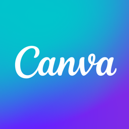 | [Canva](designs/canva/DESIGN.md) | Productivity | Friendly purple buttons, a teal-to-violet gradient and a canvas-first editor. | [preview](https://brands.nickharty.com/canva) |
| 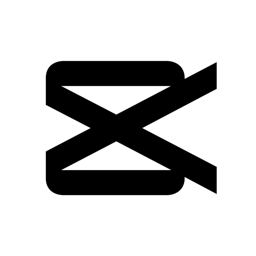 | [CapCut](designs/capcut/DESIGN.md) | Productivity | Black-and-white creator tool: pill CTAs, cyan glints, rounded media tiles, dark editor. | [preview](https://brands.nickharty.com/capcut) |
| 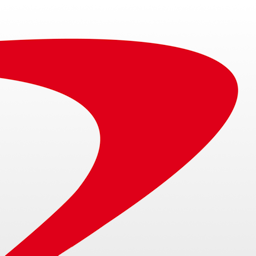 | [Capital One](designs/capital-one/DESIGN.md) | Banking | Calm navy-and-white banking: Atlantic blue, a red swoosh and card art up front. | [preview](https://brands.nickharty.com/capital-one) |
| 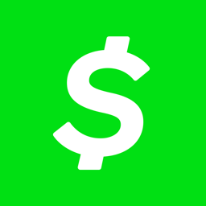 | [Cash App](designs/cash-app/DESIGN.md) | Finance | Electric green, black and white, huge wide-set numbers and pill buttons for moving money. | [preview](https://brands.nickharty.com/cash-app) |
| 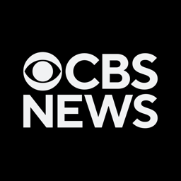 | [CBS News](designs/cbs-news/DESIGN.md) | News | Near-black header, the CBS eye, TT Norms serif stories and red live labels on a grey grid. | [preview](https://brands.nickharty.com/cbs-news) |
| 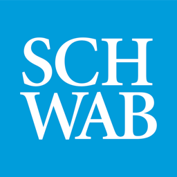 | [Charles Schwab](designs/charles-schwab/DESIGN.md) | Finance | Schwab blue square logo, teal-blue square buttons, light Charles Modern headlines. | [preview](https://brands.nickharty.com/charles-schwab) |
| 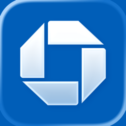 | [Chase](designs/chase/DESIGN.md) | Banking | Blue octagon, light Open Sans headlines, white panels and small-radius blue CTAs. | [preview](https://brands.nickharty.com/chase) |
| 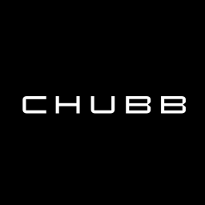 | [Chubb](designs/chubb/DESIGN.md) | Insurance | Black-and-white serif headlines, square black buttons and a purple hover accent. | [preview](https://brands.nickharty.com/chubb) |
| 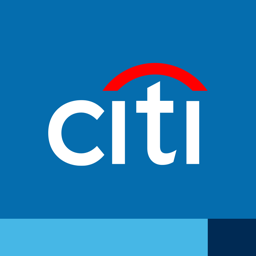 | [Citi](designs/citi/DESIGN.md) | Banking | Citi blue with a red arc, Interstate type, navy hero bands and 8px-radius blue buttons. | [preview](https://brands.nickharty.com/citi) |
|  | [Claude](designs/claude/DESIGN.md) | AI | Warm cream paper, near-black ink, a terracotta spark and calm serif headlines. | [preview](https://brands.nickharty.com/claude) |
|  | [Cloudflare](designs/cloudflare/DESIGN.md) | Developer | Clean white canvas, Cloudflare orange, Kunst Grotesk headlines and soft pill buttons. | [preview](https://brands.nickharty.com/cloudflare) |
| 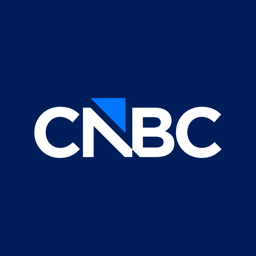 | [CNBC](designs/cnbc/DESIGN.md) | News | Deep navy nav, peacock logo, Proxima Nova headlines and green-red market quote strips. | [preview](https://brands.nickharty.com/cnbc) |
| 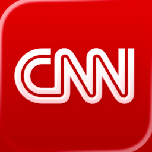 | [CNN](designs/cnn/DESIGN.md) | News | Black header, red CNN box, one sans family and tight grids of photo-led headlines. | [preview](https://brands.nickharty.com/cnn) |
|  | [Columbia University](designs/columbia/DESIGN.md) | Education | Columbia Blue and deep navy, the crown, classical serif capitals and New York photography. | [preview](https://brands.nickharty.com/columbia) |
| 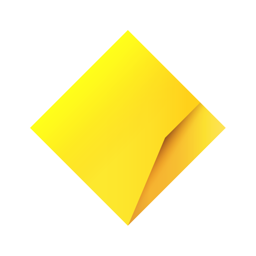 | [Commonwealth Bank](designs/commonwealth-bank/DESIGN.md) | Banking | Yellow diamond, near-black type, heavy Beacon Sans headings and yellow pill CTAs. | [preview](https://brands.nickharty.com/commonwealth-bank) |
|  | [Cornell University](designs/cornell/DESIGN.md) | Education | Carnelian red first and only, a red header band, Freight type and the Cornell seal. | [preview](https://brands.nickharty.com/cornell) |
| 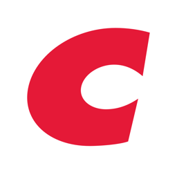 | [Costco](designs/costco/DESIGN.md) | Commerce | No-frills warehouse retail: red and blue logo, plain white pages, dense product grids. | [preview](https://brands.nickharty.com/costco) |
| 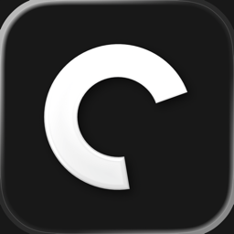 | [The Criterion Channel](designs/criterion-channel/DESIGN.md) | Streaming | Charcoal screen, old-gold accents, serif titles: a repertory cinema on demand. | [preview](https://brands.nickharty.com/criterion-channel) |
|  | [CrowdStrike](designs/crowdstrike/DESIGN.md) | Developer | Black and white security brand cut with Falcon red, heavy headlines and claw marks. | [preview](https://brands.nickharty.com/crowdstrike) |
|  | [Crunchyroll](designs/crunchyroll/DESIGN.md) | Streaming | Anime on black: a bold orange eye, square buttons, and poster walls built for fans. | [preview](https://brands.nickharty.com/crunchyroll) |
|  | [Dartmouth College](designs/dartmouth/DESIGN.md) | Education | Dartmouth Green and near-black forest, Ruzicka serif headlines, National 2 and the D-Pine. | [preview](https://brands.nickharty.com/dartmouth) |
|  | [Databricks](designs/databricks/DESIGN.md) | AI | Lava-red and deep navy data platform brand on warm oat paper, set in DM Sans and DM Mono. | [preview](https://brands.nickharty.com/databricks) |
|  | [Datadog](designs/datadog/DESIGN.md) | Developer | Bold purple observability brand: Bits the dog, uppercase CTAs and dense product grids. | [preview](https://brands.nickharty.com/datadog) |
| 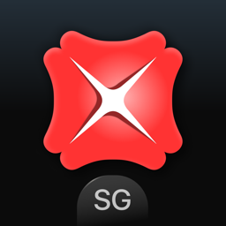 | [DBS](designs/dbs/DESIGN.md) | Banking | Red star mark, crisp white pages, Public Sans type and small-radius red buttons. | [preview](https://brands.nickharty.com/dbs) |
|  | [Deadline](designs/deadline/DESIGN.md) | News | Slab-serif DEADLINE masthead, dense breaking-news river, bold sans heads, crimson tags. | [preview](https://brands.nickharty.com/deadline) |
|  | [Dell](designs/dell/DESIGN.md) | Hardware | Dense white storefront in Roboto, Dell blue buttons with 2px corners and navy promo bands. | [preview](https://brands.nickharty.com/dell) |
| 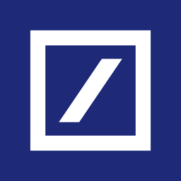 | [Deutsche Bank](designs/deutsche-bank/DESIGN.md) | Banking | Blue slash-in-a-square, white pages, deep blue panels, vivid cyan accents, 2px corners. | [preview](https://brands.nickharty.com/deutsche-bank) |
|  | [Discord](designs/discord/DESIGN.md) | Social | Blurple chat app for friend groups: dark three-column UI, rounded avatars, loud type. | [preview](https://brands.nickharty.com/discord) |
| 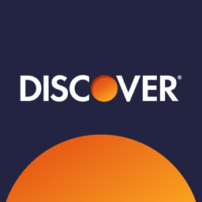 | [Discover](designs/discover/DESIGN.md) | Banking | Sunset-orange accents, deep navy and rounded Discover Sans for cards and online banking. | [preview](https://brands.nickharty.com/discover) |
| 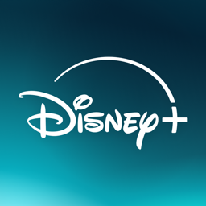 | [Disney+](designs/disney-plus/DESIGN.md) | Streaming | Deep navy, teal glow, white script logo and franchise tiles: a family streaming UI. | [preview](https://brands.nickharty.com/disney-plus) |
| 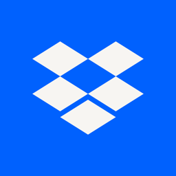 | [Dropbox](designs/dropbox/DESIGN.md) | Productivity | Blue box glyph, warm coconut neutrals, Sharp Grotesk headlines and bold color blocks. | [preview](https://brands.nickharty.com/dropbox) |
|  | [Electronic Arts](designs/electronic-arts/DESIGN.md) | Gaming | Midnight navy canvas, full-bleed key art, bold EA Display type and electric blue CTAs. | [preview](https://brands.nickharty.com/electronic-arts) |
| 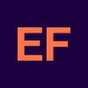 | [Entrepreneurs First](designs/entrepreneur-first/DESIGN.md) | Accelerator | Huge uppercase serif headlines, violet and orange blocks, square corners and arrow links. | [preview](https://brands.nickharty.com/entrepreneur-first) |
|  | [Facebook](designs/facebook/DESIGN.md) | Social | Friendly, dense, blue-and-grey feed UI built for billions of daily scrolls. | [preview](https://brands.nickharty.com/facebook) |
| 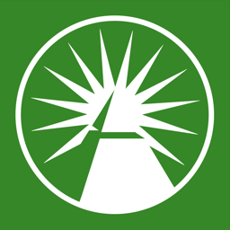 | [Fidelity](designs/fidelity/DESIGN.md) | Finance | Fidelity green on warm white, italic wordmark, pill buttons and calm, goal-led guidance. | [preview](https://brands.nickharty.com/fidelity) |
| 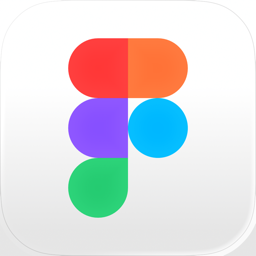 | [Figma](designs/figma/DESIGN.md) | Productivity | Black and white canvas, huge condensed headlines, five-color logo as the only rainbow. | [preview](https://brands.nickharty.com/figma) |
| 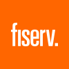 | [Fiserv](designs/fiserv/DESIGN.md) | Finance | Corporate fintech in Fiserv orange, near-black and navy, with condensed Univers type. | [preview](https://brands.nickharty.com/fiserv) |
|  | [Fortinet](designs/fortinet/DESIGN.md) | Hardware | Black, white and Fortinet red, bold Inter caps buttons and the grid-shaped O. | [preview](https://brands.nickharty.com/fortinet) |
|  | [FOX One](designs/fox/DESIGN.md) | Streaming | Black-screen streaming for FOX news, sports and shows: heavy block type and live badges. | [preview](https://brands.nickharty.com/fox) |
|  | [Fox News](designs/fox-news/DESIGN.md) | News | Navy and red broadcast palette, black-weight Roboto headlines and a dense photo grid. | [preview](https://brands.nickharty.com/fox-news) |
| 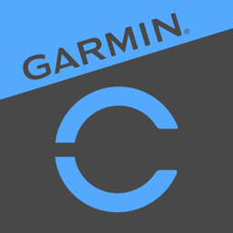 | [Garmin](designs/garmin/DESIGN.md) | Hardware | Black and white retail, condensed Oswald headings, outdoor photos and a small blue delta. | [preview](https://brands.nickharty.com/garmin) |
| 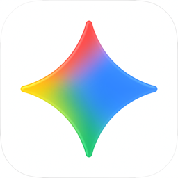 | [Google Gemini](designs/gemini/DESIGN.md) | AI | Quiet Material 3 chat canvas, a big rounded prompt box and a four-colour gradient spark. | [preview](https://brands.nickharty.com/gemini) |
| 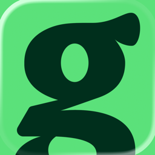 | [Giftful](designs/giftful/DESIGN.md) | Commerce | Wishlist app in leafy greens: soft serif wordmark, clean white lists, emerald actions. | [preview](https://brands.nickharty.com/giftful) |
| 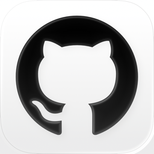 | [GitHub](designs/github/DESIGN.md) | Developer | Primer-built code home: Invertocat mark, green primary buttons, blue links, dense gray UI. | [preview](https://brands.nickharty.com/github) |
|  | [GitLab](designs/gitlab/DESIGN.md) | Developer | Tanuki orange on near-black ink and lavender-white, GitLab Sans type, Pajamas product UI. | [preview](https://brands.nickharty.com/gitlab) |
|  | [Goldman Sachs](designs/goldman-sachs/DESIGN.md) | Finance | Black serif wordmark, square corners and quiet GS blue on an editorial white page. | [preview](https://brands.nickharty.com/goldman-sachs) |
| 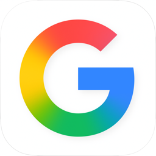 | [Google](designs/google/DESIGN.md) | Productivity | White space, one search box and four primary colours: Material 3 at its plainest. | [preview](https://brands.nickharty.com/google) |
| 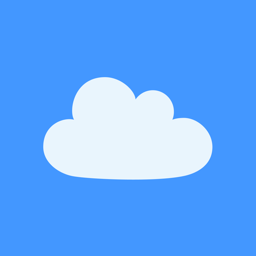 | [GoWish](designs/gowish/DESIGN.md) | Commerce | Cheerful sky-blue cloud, warm cream panels and serif headlines for sharing wishlists. | [preview](https://brands.nickharty.com/gowish) |
|  | [Grab](designs/grab/DESIGN.md) | Transport | Bright Grab green, rounded headline type and pill CTAs for Southeast Asia's super-app. | [preview](https://brands.nickharty.com/grab) |
|  | [Harvard University](designs/harvard/DESIGN.md) | Education | Crimson Veritas shield on parchment gray, Canela headlines and red arrow links. | [preview](https://brands.nickharty.com/harvard) |
|  | [HBO Max](designs/hbo-max/DESIGN.md) | Streaming | Black, silver and steel blue: a quiet premium streaming UI that lets the HBO name lead. | [preview](https://brands.nickharty.com/hbo-max) |
|  | [HDFC Bank](designs/hdfc-bank/DESIGN.md) | Banking | Navy-blue bar with the red-and-white square emblem, Open Sans, dense product carousels. | [preview](https://brands.nickharty.com/hdfc-bank) |
|  | [The Hollywood Reporter](designs/hollywood-reporter/DESIGN.md) | News | Red script masthead, Kepler serif headlines, Karla caps labels and a magazine grid. | [preview](https://brands.nickharty.com/hollywood-reporter) |
|  | [HP](designs/hp/DESIGN.md) | Hardware | Clean white storefront, electric blue circle logo, Forma DJR type and 8px rounded buttons. | [preview](https://brands.nickharty.com/hp) |
|  | [HSBC](designs/hsbc/DESIGN.md) | Banking | Red hexagon on white, ultra-light Univers headlines, square corners and black text. | [preview](https://brands.nickharty.com/hsbc) |
|  | [HubSpot](designs/hubspot/DESIGN.md) | Productivity | Sprocket-orange CRM brand on warm cream with light serif headlines and 2px-border buttons. | [preview](https://brands.nickharty.com/hubspot) |
|  | [Hulu](designs/hulu/DESIGN.md) | Streaming | Charcoal canvas, one electric green, uppercase CTAs: a TV-first streaming UI. | [preview](https://brands.nickharty.com/hulu) |
|  | [IBM](designs/ibm/DESIGN.md) | Developer | Carbon: IBM Plex, Blue 60, square corners, a strict 2x grid and the 8-bar logo. | [preview](https://brands.nickharty.com/ibm) |
|  | [ING](designs/ing/DESIGN.md) | Banking | ING orange lion, deep blue serif wordmark, rounded INGMe type and a floating pill nav. | [preview](https://brands.nickharty.com/ing) |
|  | [Instagram](designs/instagram/DESIGN.md) | Social | Photo-first, chrome-light grid with a warm gradient glyph and one action blue. | [preview](https://brands.nickharty.com/instagram) |
|  | [Interactive Brokers](designs/interactive-brokers/DESIGN.md) | Finance | Black nav, signal-red square buttons and dense Proxima Nova copy for active traders. | [preview](https://brands.nickharty.com/interactive-brokers) |
|  | [Intuit](designs/intuit/DESIGN.md) | Finance | Super blue wordmark, blueberry pill buttons, Avenir Next and round product icons. | [preview](https://brands.nickharty.com/intuit) |
|  | [Jane Street](designs/jane-street/DESIGN.md) | Finance | Black and white with one deep blue, humanist sans, uppercase nav and hexagon art. | [preview](https://brands.nickharty.com/jane-street) |
|  | [JPMorgan Chase](designs/jpmorgan/DESIGN.md) | Banking | Black serif wordmark, light Tiempos headlines, travertine panels and bronze accents. | [preview](https://brands.nickharty.com/jpmorgan) |
|  | [Kalshi](designs/kalshi/DESIGN.md) | Finance | Clean exchange UI: white canvas, mint-green brand, Yes/No price buttons on every card. | [preview](https://brands.nickharty.com/kalshi) |
|  | [Kinoki](designs/kinoki/DESIGN.md) | Social | Cream and black, a hand-drawn eye, Bookman serif titles and native Liquid Glass. | [preview](https://brands.nickharty.com/kinoki) |
|  | [KKR](designs/kkr/DESIGN.md) | Finance | Aubergine light-weight type, wide tracking, sunshine-yellow buttons and deep teal text. | [preview](https://brands.nickharty.com/kkr) |
|  | [Klarna](designs/klarna/DESIGN.md) | Finance | Soft pink brand, near-black ink and big rounded cards for payments, shopping and banking. | [preview](https://brands.nickharty.com/klarna) |
|  | [Kraken](designs/kraken/DESIGN.md) | Finance | Crypto exchange in Kraken purple on white, rounded tentacle mark and soft 12px corners. | [preview](https://brands.nickharty.com/kraken) |
|  | [Los Angeles Times](designs/la-times/DESIGN.md) | News | Blackletter masthead, Kis Display headlines, Georgia body and teal links on white. | [preview](https://brands.nickharty.com/la-times) |
|  | [Legendary Entertainment](designs/legendary/DESIGN.md) | Studio | Midnight navy, uppercase Gotham and kaiju-scale video heroes from the Dune studio. | [preview](https://brands.nickharty.com/legendary) |
|  | [Lemonade](designs/lemonade/DESIGN.md) | Insurance | Hot pink on clean white, a script L logo, friendly Lato type and soft floating cards. | [preview](https://brands.nickharty.com/lemonade) |
|  | [Lenovo](designs/lenovo/DESIGN.md) | Hardware | Red box logo, near-black plum text and Montserrat headlines over bright product renders. | [preview](https://brands.nickharty.com/lenovo) |
|  | [Letterboxd](designs/letterboxd/DESIGN.md) | Social | Dark, cinematic, poster-first social diary for film lovers. | [preview](https://brands.nickharty.com/letterboxd) |
|  | [Life360](designs/life360/DESIGN.md) | Social | Purple, map-first family safety: avatar pins, bottom sheets and calm reassurance. | [preview](https://brands.nickharty.com/life360) |
|  | [Linear](designs/linear/DESIGN.md) | Productivity | Near-black, precise and fast: Inter at odd weights, hairline borders, indigo accents. | [preview](https://brands.nickharty.com/linear) |
|  | [Lionsgate](designs/lionsgate/DESIGN.md) | Studio | Black screen, heavy white wordmark, steel-blue glow: a franchise studio built on key art. | [preview](https://brands.nickharty.com/lionsgate) |
|  | [Lloyds Bank](designs/lloyds/DESIGN.md) | Banking | Black horse on white, deep and bright greens, bold GT Ultra headlines, calm UK banking. | [preview](https://brands.nickharty.com/lloyds) |
|  | [Logitech](designs/logitech/DESIGN.md) | Hardware | Clean white retail with brand-black type, pill buttons, mint teal accents and a cyan logo. | [preview](https://brands.nickharty.com/logitech) |
|  | [Lyft](designs/lyft/DESIGN.md) | Transport | Warm off-white and black cherry, a hot pink wordmark and big pill buttons. | [preview](https://brands.nickharty.com/lyft) |
|  | [Marqeta](designs/marqeta/DESIGN.md) | Finance | Cream canvas, aubergine text, electric violet buttons and huge light grotesk headlines. | [preview](https://brands.nickharty.com/marqeta) |
|  | [Mercado Libre](designs/mercadolibre/DESIGN.md) | Commerce | Sunny yellow header, white product cards on grey, blue buttons and green free-shipping. | [preview](https://brands.nickharty.com/mercadolibre) |
|  | [Mercury](designs/mercury/DESIGN.md) | Finance | Dark, dreamy banking: indigo-black canvas, soft serif and sans type, periwinkle accents. | [preview](https://brands.nickharty.com/mercury) |
|  | [MetLife](designs/metlife/DESIGN.md) | Insurance | Deep MetLife navy, blue-to-green M mark, Ivy Presto serif headlines and calm Inter UI. | [preview](https://brands.nickharty.com/metlife) |
|  | [Micron](designs/micron/DESIGN.md) | Hardware | Black-and-white memory maker with a signature electric violet and a wave-tailed wordmark. | [preview](https://brands.nickharty.com/micron) |
|  | [Microsoft](designs/microsoft/DESIGN.md) | Productivity | Fluent 2: Segoe UI, communication blue, soft layered surfaces and the four-square mark. | [preview](https://brands.nickharty.com/microsoft) |
|  | [Minecraft](designs/minecraft/DESIGN.md) | Gaming | Blocky stone wordmark, grass-block greens, square bevelled buttons and pixel fonts. | [preview](https://brands.nickharty.com/minecraft) |
|  | [MongoDB](designs/mongodb/DESIGN.md) | Developer | Spring-green leaf on deep slate, Söhne sans with a serif wordmark, LeafyGreen product UI. | [preview](https://brands.nickharty.com/mongodb) |
|  | [Monzo](designs/monzo/DESIGN.md) | Banking | Hot Coral on clean white and deep navy, pill buttons and friendly, plain-spoken banking. | [preview](https://brands.nickharty.com/monzo) |
|  | [Moody's](designs/moodys/DESIGN.md) | Finance | Deep navy, serif headlines and bright blue links for a ratings and research house. | [preview](https://brands.nickharty.com/moodys) |
|  | [Morgan Stanley](designs/morgan-stanley/DESIGN.md) | Finance | Clean black wordmark, deep navy heroes and a precise blue token system on white. | [preview](https://brands.nickharty.com/morgan-stanley) |
|  | [MS NOW](designs/ms-now/DESIGN.md) | News | Electric blue flag mark, condensed Century headlines, Helvetica Now UI on a white feed. | [preview](https://brands.nickharty.com/ms-now) |
|  | [MSCI](designs/msci/DESIGN.md) | Finance | Electric-blue bands, tight-tracked Inter headlines and turquoise pills for index data. | [preview](https://brands.nickharty.com/msci) |
|  | [MUBI](designs/mubi/DESIGN.md) | Streaming | White page, MUBI blue, uppercase Riforma: a curated cinema that reads like a magazine. | [preview](https://brands.nickharty.com/mubi) |
|  | [NBC News](designs/nbc-news/DESIGN.md) | News | White pages, condensed grotesk headlines, Publico body copy and the six-colour peacock. | [preview](https://brands.nickharty.com/nbc-news) |
|  | [NEON](designs/neon/DESIGN.md) | Studio | White page, black type shouting in condensed caps, and a tube-lit wordmark. | [preview](https://brands.nickharty.com/neon) |
|  | [Netflix](designs/netflix/DESIGN.md) | Entertainment | Black canvas, red signal, wall-to-wall artwork: a streaming UI built for the couch. | [preview](https://brands.nickharty.com/netflix) |
|  | [The New York Times](designs/new-york-times/DESIGN.md) | News | Blackletter masthead, Cheltenham headlines, Imperial body text and hairline column rules. | [preview](https://brands.nickharty.com/new-york-times) |
|  | [The New Yorker](designs/new-yorker/DESIGN.md) | News | Irvin display type, Caslon body text, cartoons, covers and generous white space. | [preview](https://brands.nickharty.com/new-yorker) |
|  | [Nintendo](designs/nintendo/DESIGN.md) | Gaming | Nintendo red on clean white, rounded Geologica type and character art in friendly tiles. | [preview](https://brands.nickharty.com/nintendo) |
|  | [Notion](designs/notion/DESIGN.md) | Productivity | Quiet, paper-like workspace: warm greys, black ink, one blue, hand-drawn people. | [preview](https://brands.nickharty.com/notion) |
|  | [NPR](designs/npr/DESIGN.md) | News | Red, black and blue NPR blocks, clean white story lists and audio-first play buttons. | [preview](https://brands.nickharty.com/npr) |
|  | [Nubank](designs/nubank/DESIGN.md) | Banking | Nu purple everywhere, the looping nu mark, Nu Sans type, pill buttons and soft cards. | [preview](https://brands.nickharty.com/nubank) |
|  | [NVIDIA](designs/nvidia/DESIGN.md) | Hardware | Black and white engineering pages lit by one signal green, sharp corners, dense specs. | [preview](https://brands.nickharty.com/nvidia) |
|  | [NYSE](designs/nyse/DESIGN.md) | Finance | Black-and-white exchange site with square corners, Suisse type and an ice-blue bracket. | [preview](https://brands.nickharty.com/nyse) |
|  | [OnePay](designs/onepay/DESIGN.md) | Banking | Off-white and near-black fintech with sky-blue highlights and bold, tight headlines. | [preview](https://brands.nickharty.com/onepay) |
|  | [Palantir](designs/palantir/DESIGN.md) | AI | Stark black and white, Alliance type, square buttons and Blueprint's dense dark data UI. | [preview](https://brands.nickharty.com/palantir) |
|  | [Palo Alto Networks](designs/palo-alto-networks/DESIGN.md) | Developer | Charcoal and white enterprise security with a hot orange chevron and pill CTAs. | [preview](https://brands.nickharty.com/palo-alto-networks) |
|  | [Paramount](designs/paramount/DESIGN.md) | Studio | A snow-capped peak under an arc of stars, in deep navy and Paramount blue. | [preview](https://brands.nickharty.com/paramount) |
|  | [Paramount+](designs/paramount-plus/DESIGN.md) | Streaming | Electric blue on black, a starred mountain, and capital-letter headlines over big key art. | [preview](https://brands.nickharty.com/paramount-plus) |
|  | [Partiful](designs/partiful/DESIGN.md) | Social | Party-poster invites on dark, playful themes, a blobby P and lowercase party-text energy. | [preview](https://brands.nickharty.com/partiful) |
|  | [PayPal](designs/paypal/DESIGN.md) | Finance | Trusted-blue payments: deep navy marks, bright blue actions, pill buttons on clean white. | [preview](https://brands.nickharty.com/paypal) |
|  | [Peacock](designs/peacock/DESIGN.md) | Streaming | Black screen, white lowercase wordmark, a stack of colour dots and a gold pill button. | [preview](https://brands.nickharty.com/peacock) |
|  | [Pear VC](designs/pear-vc/DESIGN.md) | Accelerator | Cream pages, soft green-to-lime gradients, rounded pill buttons and a faceted green pear. | [preview](https://brands.nickharty.com/pear-vc) |
|  | [Pinterest](designs/pinterest/DESIGN.md) | Social | Masonry grid of rounded image pins on warm white, with one red Save button. | [preview](https://brands.nickharty.com/pinterest) |
|  | [Pixar Animation Studios](designs/pixar/DESIGN.md) | Studio | A quiet white gallery of film art, light Proxima Nova and the serif wordmark. | [preview](https://brands.nickharty.com/pixar) |
|  | [Plaid](designs/plaid/DESIGN.md) | Finance | Ink-black type on white, deep teal heroes, mint-to-blue gradients and code-first proof. | [preview](https://brands.nickharty.com/plaid) |
|  | [PlayStation](designs/playstation/DESIGN.md) | Gaming | Clean white and deep black stages, PlayStation blue pills and big game key art. | [preview](https://brands.nickharty.com/playstation) |
|  | [Pluto TV](designs/pluto-tv/DESIGN.md) | Streaming | Black canvas, highlighter yellow, and a channel guide that scrolls like cable. | [preview](https://brands.nickharty.com/pluto-tv) |
|  | [Politico](designs/politico/DESIGN.md) | News | Red POLITICO wordmark, black-and-white story grids and dense policy newsletters. | [preview](https://brands.nickharty.com/politico) |
|  | [Polymarket](designs/polymarket/DESIGN.md) | Finance | Dense market grid, crisp Inter, cobalt brand blue and chunky 3D Yes/No trade buttons. | [preview](https://brands.nickharty.com/polymarket) |
|  | [Prime Video](designs/prime-video/DESIGN.md) | Streaming | Midnight blue-black, glowing blue pills, big hero cards: Amazon's 2024 streaming redesign. | [preview](https://brands.nickharty.com/prime-video) |
|  | [Princeton University](designs/princeton/DESIGN.md) | Education | Princeton orange and black, the Vet Nov Tam shield, serif capitals, stone campus. | [preview](https://brands.nickharty.com/princeton) |
|  | [Progressive](designs/progressive/DESIGN.md) | Insurance | Bright blue italic wordmark, big ZIP-code quote box and pastel product tiles on white. | [preview](https://brands.nickharty.com/progressive) |
|  | [Prudential](designs/prudential/DESIGN.md) | Insurance | Rock of Gibraltar blue, navy heroes, yellow accents, pill buttons, one big rounded corner. | [preview](https://brands.nickharty.com/prudential) |
|  | [Qualcomm](designs/qualcomm/DESIGN.md) | Hardware | Clean white chip-maker pages, one electric Qualcomm blue, and a Snapdragon red sub-brand. | [preview](https://brands.nickharty.com/qualcomm) |
|  | [Quince](designs/quince/DESIGN.md) | Commerce | Quiet luxury retail: warm off-black on white, serif headlines and big product photography. | [preview](https://brands.nickharty.com/quince) |
|  | [Rakuten](designs/rakuten/DESIGN.md) | Commerce | Purple cash-back rates, Stag serif headlines and pill buttons on a clean white store grid. | [preview](https://brands.nickharty.com/rakuten) |
|  | [Ramp](designs/ramp/DESIGN.md) | Finance | Warm stone neutrals, near-black type, sharp Solar yellow and sky-gradient product shots. | [preview](https://brands.nickharty.com/ramp) |
|  | [ReciMe](designs/recime/DESIGN.md) | Food | Warm cookbook feel: parchment, blueberry blue, corn yellow, Caslon heads and mango CTAs. | [preview](https://brands.nickharty.com/recime) |
|  | [Reddit](designs/reddit/DESIGN.md) | Social | OrangeRed Snoo, Reddit Sans and dense pill-button feeds of posts, votes and threads. | [preview](https://brands.nickharty.com/reddit) |
|  | [ReelShort](designs/reelshort/DESIGN.md) | Streaming | Black-stage vertical drama streaming: poster rows, red Hot tags, gold-ranked top 10. | [preview](https://brands.nickharty.com/reelshort) |
|  | [Robinhood](designs/robinhood/DESIGN.md) | Finance | Editorial trading brand: Robin Neon on near-black, serif headlines and the feather. | [preview](https://brands.nickharty.com/robinhood) |
|  | [Roblox](designs/roblox/DESIGN.md) | Gaming | Dark charcoal surfaces, Builder Sans type, blue actions and a grid of experience tiles. | [preview](https://brands.nickharty.com/roblox) |
|  | [Roku](designs/roku/DESIGN.md) | Streaming | Deep purple TV glow, friendly rounded type and simple tiles built for a remote. | [preview](https://brands.nickharty.com/roku) |
|  | [Salesforce](designs/salesforce/DESIGN.md) | Productivity | Cloud-blue logo, Avant Garde headlines, navy text and the Lightning Design System. | [preview](https://brands.nickharty.com/salesforce) |
|  | [Samsung](designs/samsung/DESIGN.md) | Hardware | Samsung blue wordmark, black pill CTAs, product-first pages and One UI's rounded cards. | [preview](https://brands.nickharty.com/samsung) |
|  | [Santander](designs/santander/DESIGN.md) | Banking | Santander red flame on white, rounded Headline type, red pill buttons and sky-blue tints. | [preview](https://brands.nickharty.com/santander) |
|  | [SAP](designs/sap/DESIGN.md) | Productivity | Fiori Horizon: the 72 typeface, SAP blue, soft grey shell and dense enterprise tables. | [preview](https://brands.nickharty.com/sap) |
|  | [Semafor](designs/semafor/DESIGN.md) | News | Cream newsprint, a bold serif wordmark and articles split into labelled Semaform sections. | [preview](https://brands.nickharty.com/semafor) |
|  | [SHEIN](designs/shein/DESIGN.md) | Commerce | Black-and-white fashion storefront, dense product grids and orange-red sale prices. | [preview](https://brands.nickharty.com/shein) |
|  | [Shopify](designs/shopify/DESIGN.md) | Commerce | Near-black canvases, light-weight Inter headlines, pill buttons and a green shopping bag. | [preview](https://brands.nickharty.com/shopify) |
|  | [Snapchat](designs/snapchat/DESIGN.md) | Social | Electric yellow and a white ghost: camera-first, full-bleed, colour-coded chat. | [preview](https://brands.nickharty.com/snapchat) |
|  | [SoFi](designs/sofi/DESIGN.md) | Banking | Clean all-in-one money app look: SoFi teal-blue, TT Norms type and the nine-dot mark. | [preview](https://brands.nickharty.com/sofi) |
|  | [Sony Pictures](designs/sony-pictures/DESIGN.md) | Studio | Ink-navy and white, condensed uppercase headlines, one cyan accent and the Columbia torch. | [preview](https://brands.nickharty.com/sony-pictures) |
|  | [Spotify](designs/spotify/DESIGN.md) | Music | Dark, cover-art-led player UI with a single bright green and pill controls. | [preview](https://brands.nickharty.com/spotify) |
|  | [Square](designs/square/DESIGN.md) | Finance | Black and white seller tools with the rounded jewel mark, Square Sans and blue pill CTAs. | [preview](https://brands.nickharty.com/square) |
|  | [State Street](designs/state-street/DESIGN.md) | Finance | Electric blue wave mark, navy Inter text and square outline buttons on white. | [preview](https://brands.nickharty.com/state-street) |
|  | [Steam](designs/steam/DESIGN.md) | Gaming | Deep navy store, light-blue links, green buy buttons and lime discount tags on capsules. | [preview](https://brands.nickharty.com/steam) |
|  | [Storiara](designs/storiara/DESIGN.md) | Entertainment | Near-black, indigo-lit pre-production software for film and TV crews. | [preview](https://brands.nickharty.com/storiara) |
|  | [Stripe](designs/stripe/DESIGN.md) | Developer | Precise, light-weight type on white, blurple accents and a flowing gradient hero. | [preview](https://brands.nickharty.com/stripe) |
|  | [Substack](designs/substack/DESIGN.md) | News | Orange bookmark mark, clean system-font reader app and serif post pages themed per writer. | [preview](https://brands.nickharty.com/substack) |
|  | [Suno](designs/suno/DESIGN.md) | Music | Near-black studio UI, warm cream type and a glowing orange-to-pink aura around the music. | [preview](https://brands.nickharty.com/suno) |
|  | [Synced](designs/synced/DESIGN.md) | Productivity | Soft lavender light, one indigo accent, bold serif headlines and glassy iOS cards. | [preview](https://brands.nickharty.com/synced) |
|  | [Synchrony](designs/synchrony/DESIGN.md) | Finance | Warm off-white, near-black type and golden-yellow pill buttons for consumer financing. | [preview](https://brands.nickharty.com/synchrony) |
|  | [Target](designs/target/DESIGN.md) | Commerce | Bullseye red on clean white, bold Helvetica, pill buttons and bright deal-driven grids. | [preview](https://brands.nickharty.com/target) |
|  | [TD Bank](designs/td/DESIGN.md) | Banking | Green TD shield, square-cornered green buttons, Graphik type and pale-green panels. | [preview](https://brands.nickharty.com/td) |
|  | [TechCrunch](designs/techcrunch/DESIGN.md) | News | Green TC blocks, near-black header, NB International type and highlight-hover links. | [preview](https://brands.nickharty.com/techcrunch) |
|  | [Techstars](designs/techstars/DESIGN.md) | Accelerator | Bold Suisse type, black and white with a bright green underscore and pill buttons. | [preview](https://brands.nickharty.com/techstars) |
|  | [Telegram](designs/telegram/DESIGN.md) | Social | Sky-blue paper plane, light green bubbles over patterned wallpaper, fast and plain. | [preview](https://brands.nickharty.com/telegram) |
|  | [Temu](designs/temu/DESIGN.md) | Commerce | Orange-on-white discount marketplace: dense product grids, bold prices, urgency badges. | [preview](https://brands.nickharty.com/temu) |
|  | [Texas Instruments](designs/texas-instruments/DESIGN.md) | Hardware | Utilitarian engineer's catalogue: white pages, TI red actions, teal links, Roboto. | [preview](https://brands.nickharty.com/texas-instruments) |
|  | [The Economist](designs/the-economist/DESIGN.md) | News | Red box logo, Economist Serif headlines, red rules and a calm, newspaper-like grid. | [preview](https://brands.nickharty.com/the-economist) |
|  | [The Guardian](designs/the-guardian/DESIGN.md) | News | Navy masthead, yellow accents, Guardian Egyptian type and colour-coded sections. | [preview](https://brands.nickharty.com/the-guardian) |
|  | [The Verge](designs/the-verge/DESIGN.md) | News | Electric purple and mint highlights, PolySans headlines, huge Manuka display, quick posts. | [preview](https://brands.nickharty.com/the-verge) |
|  | [Threads](designs/threads/DESIGN.md) | Social | Monochrome text feed in a single rounded column, an @-loop mark and almost no colour. | [preview](https://brands.nickharty.com/threads) |
|  | [TikTok](designs/tiktok/DESIGN.md) | Social | Full-screen vertical video on black, a hot-pink action colour and a cyan-red glitch mark. | [preview](https://brands.nickharty.com/tiktok) |
|  | [TIME](designs/time/DESIGN.md) | News | Red TIME wordmark, Editorial New serif headlines and Graphik text on warm ivory and white. | [preview](https://brands.nickharty.com/time) |
|  | [Truist](designs/truist/DESIGN.md) | Banking | Deep Truist purple, soft sky and dawn tints, wide Trio type and outlined 2px buttons. | [preview](https://brands.nickharty.com/truist) |
|  | [TSMC](designs/tsmc/DESIGN.md) | Hardware | Sober corporate pages in white and charcoal, with the wafer logo's red as the only accent. | [preview](https://brands.nickharty.com/tsmc) |
|  | [Tubi](designs/tubi/DESIGN.md) | Streaming | Deep purple-black, electric yellow, chunky lowercase type: free streaming with attitude. | [preview](https://brands.nickharty.com/tubi) |
|  | [Twilio](designs/twilio/DESIGN.md) | Developer | Twilio red on deep ink and warm paper, pill buttons, code-first pages, Paste for Console. | [preview](https://brands.nickharty.com/twilio) |
|  | [Two Sigma](designs/two-sigma/DESIGN.md) | Finance | Teal diamond, oversized TT Commons headlines, square black buttons and aurora gradients. | [preview](https://brands.nickharty.com/two-sigma) |
|  | [Uber](designs/uber/DESIGN.md) | Transport | Black and white, bold Uber Move type, grey input wells and a map under every sheet. | [preview](https://brands.nickharty.com/uber) |
|  | [Unity](designs/unity/DESIGN.md) | Developer | Black and white engine brand, huge Nohemi headlines, pill buttons and a single royal blue. | [preview](https://brands.nickharty.com/unity) |
|  | [Universal Pictures](designs/universal/DESIGN.md) | Studio | The globe and arched wordmark in white on near-black, with one bright blue for action. | [preview](https://brands.nickharty.com/universal) |
|  | [University of Pennsylvania](designs/upenn/DESIGN.md) | Education | Penn Blue and Penn Red on white, Garamond headlines, and a shield dating to 1740. | [preview](https://brands.nickharty.com/upenn) |
|  | [U.S. Bank](designs/us-bank/DESIGN.md) | Banking | Red shield and deep navy, light Circular headlines, bright blue CTAs on calm white pages. | [preview](https://brands.nickharty.com/us-bank) |
|  | [USA Today](designs/usa-today/DESIGN.md) | News | A blue dot, a bold sans wordmark and bright, card-based national news on white. | [preview](https://brands.nickharty.com/usa-today) |
|  | [Vanguard](designs/vanguard/DESIGN.md) | Finance | Near-black type on white, pill buttons, bold blue links and a deep red wordmark. | [preview](https://brands.nickharty.com/vanguard) |
|  | [Variety](designs/variety/DESIGN.md) | News | Black italic VARIETY masthead, white trade-paper grid, Owners headlines, Plex serif body. | [preview](https://brands.nickharty.com/variety) |
|  | [Venmo](designs/venmo/DESIGN.md) | Finance | Venmo blue wordmark, black pill buttons, warm neutrals and a social payments feed. | [preview](https://brands.nickharty.com/venmo) |
|  | [Vercel](designs/vercel/DESIGN.md) | Developer | Monochrome Geist system: black triangle, tight Geist type, hairline borders and pill CTAs. | [preview](https://brands.nickharty.com/vercel) |
|  | [Vinted](designs/vinted/DESIGN.md) | Commerce | Clean white marketplace grid of second-hand finds, one deep teal and a hand-lettered logo. | [preview](https://brands.nickharty.com/vinted) |
|  | [Visa](designs/visa/DESIGN.md) | Finance | Visa Blue and gold on white, Visa Dialect type, 6px corners and card-art heroes. | [preview](https://brands.nickharty.com/visa) |
|  | [VIZIO](designs/vizio/DESIGN.md) | Hardware | Clean consumer-electronics retail: white pages, deep teal buttons, series color coding. | [preview](https://brands.nickharty.com/vizio) |
|  | [Vox](designs/vox/DESIGN.md) | News | Highlighter-yellow Vox mark, bold Balto headlines, Harriet serif text, explainer cards. | [preview](https://brands.nickharty.com/vox) |
|  | [Walmart](designs/walmart/DESIGN.md) | Commerce | True-blue retail: bright blue header, yellow Spark, pill buttons, big friendly prices. | [preview](https://brands.nickharty.com/walmart) |
|  | [Warner Bros.](designs/warner-bros/DESIGN.md) | Studio | Gold-rimmed blue shield on near-black: a classic studio crest rebuilt for screens. | [preview](https://brands.nickharty.com/warner-bros) |
|  | [Waymo](designs/waymo/DESIGN.md) | Transport | Calm white and midnight navy, a green-and-blue W mark and data-led safety storytelling. | [preview](https://brands.nickharty.com/waymo) |
|  | [Wealthfront](designs/wealthfront/DESIGN.md) | Finance | Eggplant and blurple gradients, tight bold Calibre headlines and soft pastel cards. | [preview](https://brands.nickharty.com/wealthfront) |
|  | [Wells Fargo](designs/wells-fargo/DESIGN.md) | Banking | Red masthead with a gold rule, warm greys, purple links and rounded red buttons. | [preview](https://brands.nickharty.com/wells-fargo) |
|  | [Whatnot](designs/whatnot/DESIGN.md) | Commerce | Live auctions on near-black, a squishy yellow W and one big yellow Bid button. | [preview](https://brands.nickharty.com/whatnot) |
|  | [Wise](designs/wise/DESIGN.md) | Finance | Bright green and forest green, heavy display type and a live rate calculator up front. | [preview](https://brands.nickharty.com/wise) |
|  | [Workday](designs/workday/DESIGN.md) | Productivity | Deep ink blue on warm white, the orange arc, bold headlines and soft pill buttons. | [preview](https://brands.nickharty.com/workday) |
|  | [X](designs/x/DESIGN.md) | Social | Black, text-first timeline with Chirp type, hairline dividers and a single sky blue. | [preview](https://brands.nickharty.com/x) |
|  | [Grok](designs/xai/DESIGN.md) | AI | Warm near-black chat canvas, one centered composer island and a slashed-orbit mark. | [preview](https://brands.nickharty.com/xai) |
|  | [Xiaomi](designs/xiaomi/DESIGN.md) | Hardware | Orange squircle, near-black MiSans type and big, glossy product photography on white. | [preview](https://brands.nickharty.com/xiaomi) |
|  | [Y Combinator](designs/y-combinator/DESIGN.md) | Accelerator | Warm beige paper, serif headlines with italic accents, and the orange Y square. | [preview](https://brands.nickharty.com/y-combinator) |
|  | [Yahoo News](designs/yahoo-news/DESIGN.md) | News | Purple yahoo!news wordmark, warm off-white feed, pill buttons and photo-led story cards. | [preview](https://brands.nickharty.com/yahoo-news) |
|  | [Yale University](designs/yale/DESIGN.md) | Education | Yale Blue, Matthew Carter's Yale typeface with Mallory, and the Lux et Veritas shield. | [preview](https://brands.nickharty.com/yale) |
|  | [YouTube](designs/youtube/DESIGN.md) | Streaming | Thumbnail grid on near-white or near-black, Roboto everywhere and one red play button. | [preview](https://brands.nickharty.com/youtube) |
|  | [Zoom](designs/zoom/DESIGN.md) | Productivity | Zoom blue on white, midnight navy text, pill buttons and Newsreader serif headlines. | [preview](https://brands.nickharty.com/zoom) |

## Get a file

From the site: open a brand to copy its curl command, download **DESIGN.md**, the logo or the icon, or hit **Add to Claude** to open a Claude chat with a prompt that builds a design system from the file.

From a terminal:

```bash
curl -o DESIGN.md https://brands.nickharty.com/designs/letterboxd/DESIGN.md
curl -o logo.svg  https://brands.nickharty.com/designs/letterboxd/logo.svg
curl -o icon.svg  https://brands.nickharty.com/designs/letterboxd/icon.svg
```

Every file is also listed in [`/designs/index.json`](https://brands.nickharty.com/designs/index.json), with CORS open, so scripts and agents can fetch the whole library.

Or clone this repo. The files live in `designs/<slug>/`: `DESIGN.md`, `logo.svg` and `icon.svg`.

## What's in a DESIGN.md

YAML frontmatter holds the tokens: colors, fonts with Google Fonts fallbacks, type scale, radii, spacing and shadows. The markdown body has the same eleven sections in every file:

1. Visual theme and atmosphere
2. Color palette and roles
3. Typography
4. Logo and brand mark
5. Components
6. Layout and spacing
7. Depth, elevation and motion
8. Iconography and imagery
9. Voice and microcopy
10. Do's and don'ts
11. Agent prompt guide

The full format is in [SPEC.md](SPEC.md).

## Adding a brand

1. Make `designs/<slug>/` with a `DESIGN.md` that follows [SPEC.md](SPEC.md) and a clean `logo.svg` (vector only, has a viewBox, no scripts or embedded images).
2. Add the brand to `scripts/make-icons.py` and run `python3 scripts/make-icons.py` to build its `icon.svg`.
3. Run `node scripts/og.mjs` to render its social preview card, then `npm run dev` and check `/<slug>`. The icon, page and downloads come from those files with no other code changes.
4. Open a pull request. Say where your values came from (live CSS, published brand guidelines) and flag anything you guessed.

## Running the site

```bash
npm install
npm run dev     # http://localhost:3000
npm run build
```

Next.js 15 (App Router, every page static) and Tailwind 3, styled after [nickharty.com](https://nickharty.com). `scripts/sync-designs.mjs` copies the files into `public/designs` before every build. `node scripts/og.mjs` renders the social preview cards (`public/og.png` and `public/og/<slug>.png`) with local Chrome; rerun it after adding a brand. Hosted on Vercel.

## Legal

These files are unofficial references written from public products and published brand guidelines. They are not affiliated with or endorsed by any of the brands. Logos and brand names are trademarks of their owners and are included so the references are complete; follow each brand's own guidelines before using its logo. Values marked as approximate in a file are best estimates.

Site code is MIT. The DESIGN.md text is CC BY 4.0.

Made by [Nick Harty](https://nickharty.com).
