<p align="center">
  
</p>

<h1 align="center">design.md library</h1>

<p align="center"><em>great artists steal to learn.</em></p>

<p align="center">
  <a href="https://design.nickharty.com">design.nickharty.com</a>
</p>

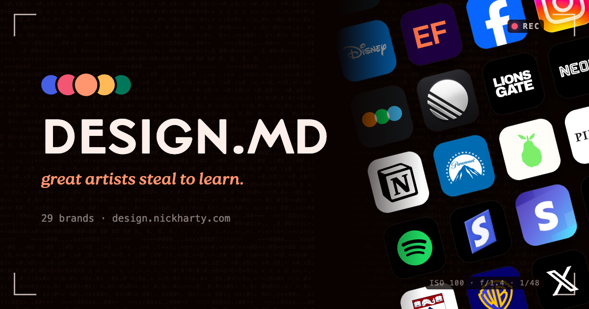

`DESIGN.md` files for brands people study: the big Hollywood studios, YC and the major accelerators, and products like Letterboxd, Instagram and Stripe. Each one covers a brand's colors, type, components, spacing, motion, voice and logo, and ends with a prompt and CSS variables for a coding agent. Every design ships with its vector logo and a square app icon (the official iOS icon from [iOS Icon Gallery](https://www.iosicongallery.com) where one exists, otherwise a vector icon).

Drop a `DESIGN.md` at the root of a project and Claude Code, Cursor, Codex or any agent that reads repo context will pick it up. Then ask for the look:

```
Build the settings page following DESIGN.md.
```

## The designs

| | Brand | Category | In one line | |
|---|---|---|---|---|
| 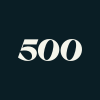 | [500 Global](designs/500-global/DESIGN.md) | Accelerator | Cream paper, deep teal ink, light serif headlines and a lime highlighter accent. | [preview](https://design.nickharty.com/500-global) |
| 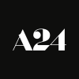 | [A24](designs/a24/DESIGN.md) | Studio | Warm black, square corners, one grotesque and the poster doing all the talking. | [preview](https://design.nickharty.com/a24) |
| 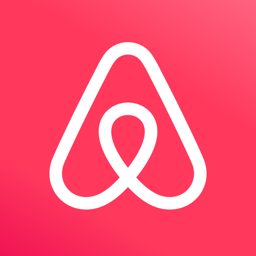 | [Airbnb](designs/airbnb/DESIGN.md) | Travel | Warm, photo-led white canvas with one coral-pink accent and soft rounded cards. | [preview](https://design.nickharty.com/airbnb) |
|  | [Amazon MGM Studios](designs/amazon-mgm-studios/DESIGN.md) | Studio | Gold, widely spaced capitals on black, with MGM's lion heritage behind them. | [preview](https://design.nickharty.com/amazon-mgm-studios) |
|  | [Antler](designs/antler/DESIGN.md) | Accelerator | Warm off-white pages, black square-cornered buttons that flash red, a pale mint accent. | [preview](https://design.nickharty.com/antler) |
| 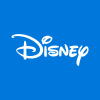 | [Disney](designs/disney/DESIGN.md) | Studio | Signature script, castle and a clear Disney blue on bright, image-led pages. | [preview](https://design.nickharty.com/disney) |
|  | [Entrepreneurs First](designs/entrepreneur-first/DESIGN.md) | Accelerator | Huge uppercase serif headlines, violet and orange blocks, square corners and arrow links. | [preview](https://design.nickharty.com/entrepreneur-first) |
|  | [Facebook](designs/facebook/DESIGN.md) | Social | Friendly, dense, blue-and-grey feed UI built for billions of daily scrolls. | [preview](https://design.nickharty.com/facebook) |
|  | [Instagram](designs/instagram/DESIGN.md) | Social | Photo-first, chrome-light grid with a warm gradient glyph and one action blue. | [preview](https://design.nickharty.com/instagram) |
|  | [Legendary Entertainment](designs/legendary/DESIGN.md) | Studio | Midnight navy, uppercase Gotham and kaiju-scale video heroes from the Dune studio. | [preview](https://design.nickharty.com/legendary) |
|  | [Letterboxd](designs/letterboxd/DESIGN.md) | Social | Dark, cinematic, poster-first social diary for film lovers. | [preview](https://design.nickharty.com/letterboxd) |
| 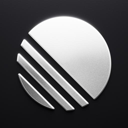 | [Linear](designs/linear/DESIGN.md) | Productivity | Near-black, precise and fast: Inter at odd weights, hairline borders, indigo accents. | [preview](https://design.nickharty.com/linear) |
|  | [Lionsgate](designs/lionsgate/DESIGN.md) | Studio | Black screen, heavy white wordmark, steel-blue glow: a franchise studio built on key art. | [preview](https://design.nickharty.com/lionsgate) |
|  | [NEON](designs/neon/DESIGN.md) | Studio | White page, black type shouting in condensed caps, and a tube-lit wordmark. | [preview](https://design.nickharty.com/neon) |
| 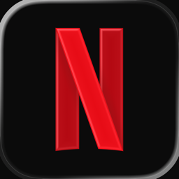 | [Netflix](designs/netflix/DESIGN.md) | Entertainment | Black canvas, red signal, wall-to-wall artwork: a streaming UI built for the couch. | [preview](https://design.nickharty.com/netflix) |
| 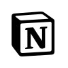 | [Notion](designs/notion/DESIGN.md) | Productivity | Quiet, paper-like workspace: warm greys, black ink, one blue, hand-drawn people. | [preview](https://design.nickharty.com/notion) |
| 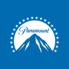 | [Paramount](designs/paramount/DESIGN.md) | Studio | A snow-capped peak under an arc of stars, in deep navy and Paramount blue. | [preview](https://design.nickharty.com/paramount) |
|  | [Pear VC](designs/pear-vc/DESIGN.md) | Accelerator | Cream pages, soft green-to-lime gradients, rounded pill buttons and a faceted green pear. | [preview](https://design.nickharty.com/pear-vc) |
|  | [Pixar Animation Studios](designs/pixar/DESIGN.md) | Studio | A quiet white gallery of film art, light Proxima Nova and the serif wordmark. | [preview](https://design.nickharty.com/pixar) |
|  | [Sony Pictures](designs/sony-pictures/DESIGN.md) | Studio | Ink-navy and white, condensed uppercase headlines, one cyan accent and the Columbia torch. | [preview](https://design.nickharty.com/sony-pictures) |
|  | [Spotify](designs/spotify/DESIGN.md) | Music | Dark, cover-art-led player UI with a single bright green and pill controls. | [preview](https://design.nickharty.com/spotify) |
| 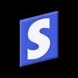 | [Storiara](designs/storiara/DESIGN.md) | Entertainment | Near-black, indigo-lit pre-production software for film and TV crews. | [preview](https://design.nickharty.com/storiara) |
|  | [Stripe](designs/stripe/DESIGN.md) | Developer | Precise, light-weight type on white, blurple accents and a flowing gradient hero. | [preview](https://design.nickharty.com/stripe) |
|  | [Techstars](designs/techstars/DESIGN.md) | Accelerator | Bold Suisse type, black and white with a bright green underscore and pill buttons. | [preview](https://design.nickharty.com/techstars) |
|  | [Universal Pictures](designs/universal/DESIGN.md) | Studio | The globe and arched wordmark in white on near-black, with one bright blue for action. | [preview](https://design.nickharty.com/universal) |
|  | [University of Pennsylvania](designs/upenn/DESIGN.md) | Education | Penn Blue and Penn Red on white, Garamond headlines, and a shield dating to 1740. | [preview](https://design.nickharty.com/upenn) |
| 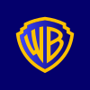 | [Warner Bros.](designs/warner-bros/DESIGN.md) | Studio | Gold-rimmed blue shield on near-black: a classic studio crest rebuilt for screens. | [preview](https://design.nickharty.com/warner-bros) |
|  | [X](designs/x/DESIGN.md) | Social | Black, text-first timeline with Chirp type, hairline dividers and a single sky blue. | [preview](https://design.nickharty.com/x) |
|  | [Y Combinator](designs/y-combinator/DESIGN.md) | Accelerator | Warm beige paper, serif headlines with italic accents, and the orange Y square. | [preview](https://design.nickharty.com/y-combinator) |

## Get a file

From the site: open a brand to copy its curl command, download **DESIGN.md**, the logo or the icon, or hit **Add to Claude** to open a Claude chat with a prompt that builds a design system from the file.

From a terminal:

```bash
curl -o DESIGN.md https://design.nickharty.com/designs/letterboxd/DESIGN.md
curl -o logo.svg  https://design.nickharty.com/designs/letterboxd/logo.svg
curl -o icon.svg  https://design.nickharty.com/designs/letterboxd/icon.svg
```

Every file is also listed in [`/designs/index.json`](https://design.nickharty.com/designs/index.json), with CORS open, so scripts and agents can fetch the whole library.

Or clone this repo. The files live in `designs/<slug>/`: `DESIGN.md`, `logo.svg` and `icon.svg`.

## What's in a DESIGN.md

YAML frontmatter holds the tokens: colors, fonts with Google Fonts fallbacks, type scale, radii, spacing and shadows. The markdown body has the same eleven sections in every file:

1. Visual theme and atmosphere
2. Color palette and roles
3. Typography
4. Logo and brand mark
5. Components
6. Layout and spacing
7. Depth, elevation and motion
8. Iconography and imagery
9. Voice and microcopy
10. Do's and don'ts
11. Agent prompt guide

The full format is in [SPEC.md](SPEC.md).

## Adding a brand

1. Make `designs/<slug>/` with a `DESIGN.md` that follows [SPEC.md](SPEC.md) and a clean `logo.svg` (vector only, has a viewBox, no scripts or embedded images).
2. Add the brand to `scripts/make-icons.py` and run `python3 scripts/make-icons.py` to build its `icon.svg`.
3. Run `node scripts/og.mjs` to render its social preview card, then `npm run dev` and check `/<slug>`. The icon, page and downloads come from those files with no other code changes.
4. Open a pull request. Say where your values came from (live CSS, published brand guidelines) and flag anything you guessed.

## Running the site

```bash
npm install
npm run dev     # http://localhost:3000
npm run build
```

Next.js 15 (App Router, every page static) and Tailwind 3, styled after [nickharty.com](https://nickharty.com). `scripts/sync-designs.mjs` copies the files into `public/designs` before every build. `node scripts/og.mjs` renders the social preview cards (`public/og.png` and `public/og/<slug>.png`) with local Chrome; rerun it after adding a brand. Hosted on Vercel.

## Legal

These files are unofficial references written from public products and published brand guidelines. They are not affiliated with or endorsed by any of the brands. Logos and brand names are trademarks of their owners and are included so the references are complete; follow each brand's own guidelines before using its logo. Values marked as approximate in a file are best estimates.

Site code is MIT. The DESIGN.md text is CC BY 4.0.

Made by [Nick Harty](https://nickharty.com).
